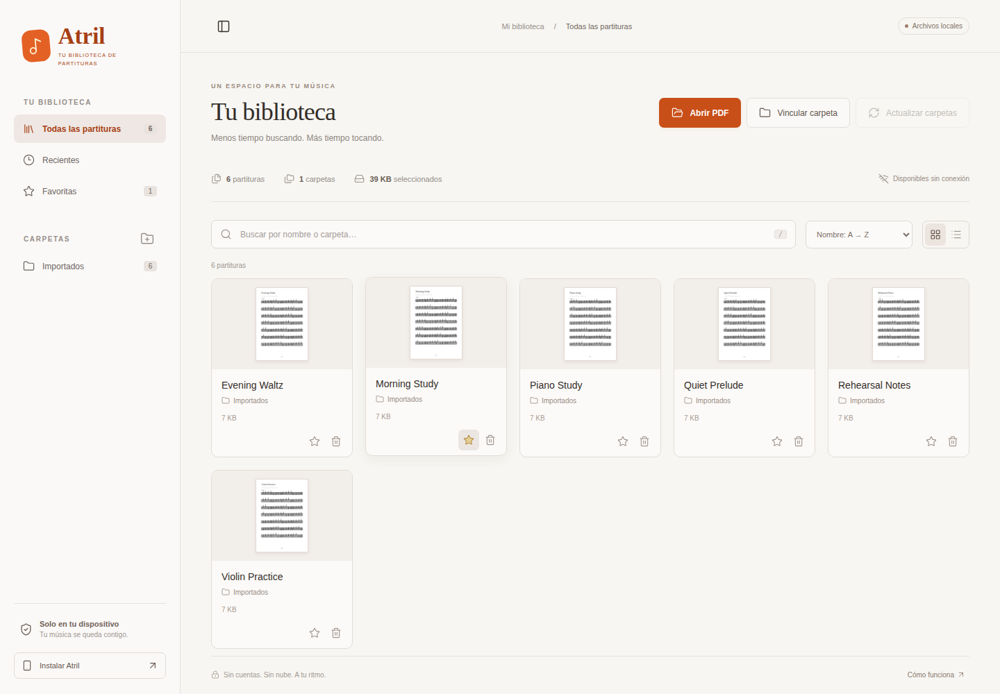
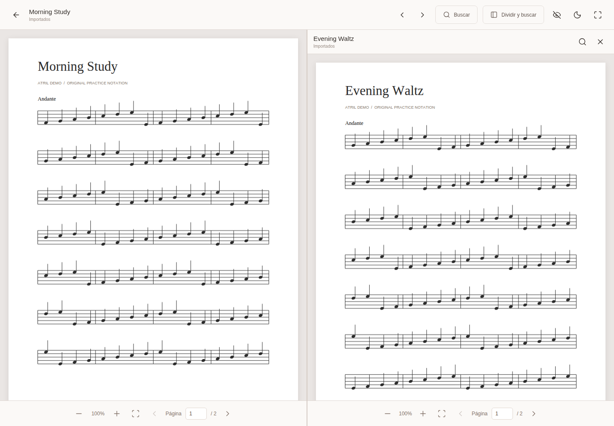

# Atril

**A local PDF sheet music library with a focused, split-screen reader.**

Atril helps musicians find and read scores already stored on their device. Link a rehearsal folder, browse its PDFs, and open two scores with independent controls—all in an installable web app, without uploading your documents.

Built with **TypeScript · Vite · PDF.js · IndexedDB · Progressive Web App APIs**.



## Features

- **Local library:** open individual PDFs or link multiple folders, including subfolders, on supported browsers.
- **Manual refresh:** load linked folders at startup, then check for added, changed, or removed files when you choose.
- **Fast discovery:** search filenames and paths without case or accent sensitivity; use favorites, recent files, and grid or list views.
- **Real previews:** first-page thumbnails load near the viewport, one PDF at a time, with a bounded in-memory cache.
- **Focused reading:** zoom, page navigation, text search, previous/next PDFs with touch swipes, a dark reader background, and collapsible controls.
- **Two scores at once:** independent scrolling, zoom, and page controls; side-by-side on larger screens and stacked on phones.
- **Installable and offline-capable:** cache the application shell and bundled PDF.js resources after the first online visit.

The interface is currently in Spanish. Documentation is in English; the [user guide](docs/user-guide.md) maps instructions to the actual button labels.

## Reader preview



Screenshots use original, generated demonstration notation. See [how to reproduce them](docs/development.md#documentation-screenshots).

## Run locally

Use **Node.js 24.x** and npm. The package also supports Node.js 22.12 or later within the 22.x series.

```sh
npm ci
npm run dev
```

Open the URL printed by Vite, normally `http://localhost:5173`. No backend, API keys, or environment variables are required. `npm ci` also prepares the local PDF.js assets.

For a production build:

```sh
npm run build
npm run preview
```

## Verify

```sh
npm test
npm run lint
npm run build
npx playwright install chromium
npm run test:e2e
```

The browser tests run against the production build. See the [development guide](docs/development.md) for browser setup, formatting, and test coverage.

## Privacy and persistence

PDF contents remain on your device. Atril requests read-only folder access and does not upload, edit, or delete the original files.

| Data                                                    | Storage              | Lifetime                                               |
| ------------------------------------------------------- | -------------------- | ------------------------------------------------------ |
| Linked folder handles and saved reading metadata        | IndexedDB            | Across sessions, until removed or site data is cleared |
| Individually selected files and current library entries | Memory               | Current session                                        |
| Thumbnail cache                                         | Memory               | Current session; up to 48 cached previews              |
| Library layout and desktop sidebar preference           | localStorage         | Across sessions                                        |
| Application shell and PDF.js assets                     | Service worker cache | Available offline after caching                        |

Favorites and reading progress persist for linked PDFs. Individually selected PDFs must be selected again after a reload. Access permissions may need to be renewed. [Storage details and limitations →](docs/architecture.md)

## Browser support

Reading selected PDFs works without persistent folder linking. That linking depends on `showDirectoryPicker`, a browser API with [limited availability](https://developer.mozilla.org/en-US/docs/Web/API/Window/showDirectoryPicker), and requires HTTPS or a trusted local development context.

If the API is unavailable, Atril offers session-only folder selection or individual PDFs. Installing the PWA does not remove these browser restrictions. Offline reading requires cached app resources and continued access to local files; cloud-backed document providers may require a connection.

## Deploy

The repository includes [vercel.json](vercel.json) for a static Vite deployment: `npm ci` → `npm run build` → `dist/`.

Connect the Git repository in Vercel and select `main` as the production branch to deploy automatically after each push or merge. [Deployment guide →](docs/deployment.md)

## Explore the project

| Document                             | Contents                                                                   |
| ------------------------------------ | -------------------------------------------------------------------------- |
| [User guide](docs/user-guide.md)     | Local files, folder actions, reader controls, split view, and installation |
| [Architecture](docs/architecture.md) | Module boundaries, data flow, storage, and engineering decisions           |
| [Development](docs/development.md)   | Setup, commands, tests, and reproducible screenshots                       |
| [Deployment](docs/deployment.md)     | Vercel Git integration, build settings, and PWA updates                    |
| [Contributing](CONTRIBUTING.md)      | Change scope, coding conventions, and review expectations                  |

## Scope

Atril is a PDF reader, not a notation editor. It does not provide OCR, password unlocking, audio playback, cloud synchronization, or background folder monitoring. It is designed to keep the original files under the musician's control.
