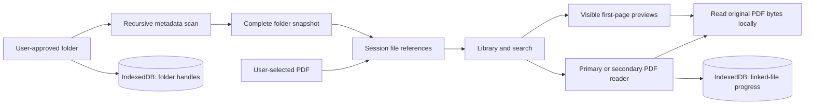

# Architecture

[Back to README](../README.md)

Atril is a client-side TypeScript application served as static files. There is no application server, user account system, or document upload endpoint.

## Stack

| Layer             | Technology                         | Responsibility                                           |
| ----------------- | ---------------------------------- | -------------------------------------------------------- |
| Interface         | TypeScript, HTML, CSS, Lucide      | Library, folder actions, responsive reader controls      |
| PDF engine        | PDF.js                             | Document loading, canvas rendering, embedded-text search |
| Local persistence | IndexedDB via `idb`                | Folder handles and reading metadata                      |
| Build             | Vite                               | Development server and static production bundle          |
| Offline shell     | `vite-plugin-pwa` / Workbox        | Service worker and app-resource precaching               |
| Verification      | Vitest, fake-indexeddb, Playwright | Unit tests and desktop/mobile browser flows              |

## Repository layout

```text
src/
  main.ts                Application state, library UI, and primary reader
  library.ts             Score metadata, search normalization, and folder paths
  linked-folders.ts      Persistent folder handles and recursive scanning
  storage.ts             Session references and saved-progress integration
  pdf.ts                 PDF.js loading, rendering, search, and cleanup
  split-reader.ts        Independent second reader and its controls
  file-swipe.ts          Touch file gestures that preserve native scrolling
  thumbnails.ts          Visibility-based preview generation and memory cache
  style.css              Responsive layout and visual styles
scripts/
  prepare-assets.mjs     Copy PDF.js resources for local/offline use
  capture-docs.mjs        Generate demo notation and documentation screenshots
public/                  App icons and generated PDF.js resources
tests/
  *.test.ts              Unit tests
  e2e/library.spec.ts     Browser workflows
docs/                    User, architecture, development, and deployment guides
vercel.json              Static deployment configuration
```

## Data flow



## Folder linking and manual synchronization

`linked-folders.ts` stores directory handles in the `folders` object store of `atril-linked-folders`. The application requests read-only access and checks permission before scanning.

A scan walks subdirectories and collects PDF metadata and file handles. It builds the entire snapshot before applying changes; a failed scan cannot remove valid entries through a partial result. The storage layer reconciles additions, updates, and removals for that folder's ID.

Linked score IDs include a generated folder ID and relative path. This keeps document identity separate when distinct linked roots share a name. Sidebar navigation groups paths by their displayed folder names, so same-named roots are not visually separated in the current interface.

The application scans at startup, after a user links a folder or restores access, and when the refresh button is pressed. It does not poll or monitor the filesystem in the background. Scans do not overlap.

## Storage boundaries

| Location             | Contents                                                                                                                         |
| -------------------- | -------------------------------------------------------------------------------------------------------------------------------- |
| Memory               | Library entries, individual `File` objects, original file handles, active PDF documents, current-session hidden scores, previews |
| IndexedDB `folders`  | Linked directory handles, generated IDs, and names                                                                               |
| IndexedDB `progress` | Metadata for linked scores when reading progress or favorites are saved                                                          |
| localStorage         | Grid/list preference and desktop sidebar visibility                                                                              |
| Service worker cache | Built app resources and local PDF.js dependencies                                                                                |

PDF bytes and thumbnail images are not persisted by Atril. Unlinking removes the folder record and its saved progress. Clearing browser site data also removes preferences, permissions/handles, and offline resources.

Favorites survive a detected PDF change; the saved page resets when size or modification time differs. This comparison is metadata-based, not a content hash: a change preserving both values is not detected. Renaming a file changes its path identity.

Legacy versions may have stored PDF copies in a separate `atril-library` database. The current implementation does not read or create that database; clearing site data removes any legacy data as well.

## Reader lifecycle

Each pane owns a `PdfReader` instance with its own loaded document, render task, page, zoom, and scroll container. Loading another score or closing a pane cancels rendering and destroys the previous document. Request counters prevent obsolete asynchronous results from replacing a newer selection.

The primary reader captures its previous/next-file queue from the visible library selection. The secondary reader selects documents independently and captures an alphabetical file queue for touch navigation. A shared gesture handler distinguishes deliberate single-finger horizontal swipes from vertical scrolling, small drags, and multi-touch. When a PDF overflows its pane horizontally, native panning takes priority over file switching. Both use the same local file access layer and save linked-file progress. If the same score is open twice, its saved progress is the most recently recorded page; there are no separate persistent bookmarks per pane.

Embedded text is extracted on demand and cached per active document for search. Atril does not run OCR.

## Thumbnail work

An `IntersectionObserver` queues previews near the viewport. One PDF is processed at a time, using an independent PDF reader to render page 1. The renderer is released after the image is generated.

The cache holds up to 48 previews in memory, keyed by score ID, size, and modification time. Visible cards also retain their displayed images. Queued work pauses when the document is hidden or a reader is open; an already-started task may finish. Failed previews retain the sheet placeholder without preventing the main reader from opening the document.

## Offline delivery

The build generates a service worker and precaches the application shell. `prepare-assets.mjs`, run by `postinstall`, copies PDF.js character maps, standard fonts, and WebAssembly resources into `public/pdfjs/`. Runtime PDF reading does not depend on a CDN.

Offline delivery does not grant filesystem access. The browser must still provide a selected file or an authorized folder handle. Cloud-backed providers may require network access.

## Current boundaries

- Persistent folder linking depends on browser support for `showDirectoryPicker` and a secure context.
- The interface is Spanish; documentation is English.
- Password-protected PDFs require an unencrypted copy.
- There is no OCR, score editing, playback, cloud synchronization, or automatic folder watching.
- Browser tests emulate a phone viewport and filesystem flows; they do not certify every physical tablet, browser, or document provider.
