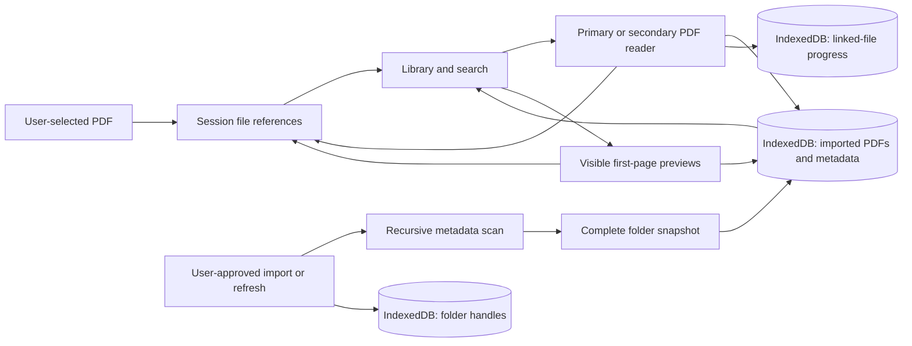

# Architecture

[Back to README](../README.md)

Atril is a client-side TypeScript application served as static files. There is no application server, user account system, or document upload endpoint.

## Stack

| Layer             | Technology                         | Responsibility                                           |
| ----------------- | ---------------------------------- | -------------------------------------------------------- |
| Interface         | TypeScript, HTML, CSS, Lucide      | Library, folder actions, responsive reader controls      |
| PDF engine        | PDF.js                             | Document loading, canvas rendering, embedded-text search |
| Local persistence | IndexedDB via `idb`                | Folder handles, imported PDF bytes, and reading metadata |
| Build             | Vite                               | Development server and static production bundle          |
| Offline shell     | `vite-plugin-pwa` / Workbox        | Service worker and app-resource precaching               |
| Verification      | Vitest, fake-indexeddb, Playwright | Unit tests and desktop/mobile browser flows              |

## Repository layout

```text
src/
  main.ts                Application state, library UI, and primary reader
  library.ts             Score metadata, search normalization, and folder paths
  linked-folders.ts      Persistent imports, folder handles, and recursive scanning
  storage.ts             Session files, imported snapshots, and reading progress
  library-state.ts       Validated location, folder expansion, and ordered reading list
  pdf.ts                 PDF.js loading, rendering, search, and cleanup
  pdf-resolution.ts      Native screen density and bounded canvas dimensions
  split-reader.ts        Independent second reader and its controls
  file-swipe.ts          Touch file gestures that preserve native scrolling
  long-press-selection.ts Delegated touch selection that preserves taps and scrolling
  thumbnails.ts          Visibility-based preview generation and memory cache
  style.css              Responsive layout and visual styles
scripts/
  prepare-assets.mjs     Copy PDF.js resources for local/offline use
  capture-docs.mjs        Generate demo notation and documentation screenshots
public/                  App icons and generated PDF.js resources
tests/
  *.test.ts              Unit tests
  e2e/library.spec.ts     Browser workflows
docs/                    User, architecture, development, and deployment guides
vercel.json              Static deployment configuration
```

## Data flow



## Folder linking and manual synchronization

`linked-folders.ts` stores directory handles in the `folders` object store of `atril-linked-folders`. The application requests read-only access and checks permission before scanning.

A scan excludes hidden/trash entries and known filesystem metadata directories before reading their handles, and collects PDF metadata and `File` snapshots. The storage layer reads bytes only for new or changed files, then commits the folder's metadata, PDF copies, and deletions in one IndexedDB transaction. Memory is reconciled only after the commit. Read errors, canceled permissions, and quota failures preserve the previous imported snapshot. Each folder commits independently; a failure in one does not discard successful updates to another.

Linked score IDs include a generated folder ID and relative path. This keeps document identity separate when distinct linked roots share a name. Sidebar navigation groups paths by their displayed folder names, so same-named roots are not visually separated in the current interface.

Startup restores metadata for cached documents without reading PDF bytes or consulting folder permissions. Scanning happens only after a user imports a folder, restores access, or presses the refresh button. Permission requests are initiated directly in the user gesture. The application does not poll or monitor the filesystem in the background, and scans do not overlap.

## Library navigation and reading queue

`library-state.ts` validates the saved location, sort preference, expanded folder paths, and unique ordered reading-list IDs in the `atril-library-state` localStorage entry. Invalid or older state falls back to defaults. The active location and branch expansion survive startup; unavailable saved folders fall back to the full library. Search text is not persisted.

The sidebar renders nested branches. Disclosure buttons toggle only the corresponding branch, without rebuilding PDF cards or requesting filesystem access. Library cards and previews are limited to the active folder/section and search results.

Checkboxes append PDFs in selection order. Touch users can also hold a PDF card/row for 450 ms to toggle selection; movement over 10 CSS pixels, multiple fingers, and canceled touches abort the pending hold. The release click is suppressed across card re-renders so it cannot open a PDF or hit a shifted control. Fresh touches reset that suppression. The reading-list section ignores the library sort and offers explicit up/down reordering. Starting the list supplies its complete available queue to the primary reader, independent of folder/search filters. Opening a selected PDF directly uses the same order. Reader search can open other files, and the secondary pane retains its independent alphabetical queue. Unavailable IDs are removed after startup restoration, successful refreshes, or explicit library removals.

The shared path filter also excludes previously cached hidden entries from startup metadata and library queries. Refreshing a folder cleans their persisted copies through normal snapshot reconciliation.

Primary-reader library search offers play-next and append actions through `ReaderSequence` in `reader-queue.ts`. Priority additions interrupt the original sequence without replacing it. Pending additions persist separately in the optional `priorityQueue` library-state field; older saved state remains compatible. Advancing consumes crossed priority entries, then resumes the original continuation. Navigation controls and search status labels update without reopening or rendering the current PDF. The secondary reader keeps its independent queue.

## Storage boundaries

| Location              | Contents                                                                                                      |
| --------------------- | ------------------------------------------------------------------------------------------------------------- |
| Memory                | Library entries, individual `File` objects, active PDF documents, current-session hidden scores, previews     |
| IndexedDB `folders`   | Linked directory handles, generated IDs, and names                                                            |
| IndexedDB `progress`  | Metadata for all imported PDFs, including favorites and reading progress                                      |
| IndexedDB `documents` | Imported PDF bytes as ArrayBuffers, keyed by linked score ID                                                  |
| localStorage          | Grid/list preference, desktop sidebar visibility, last location, sort, expanded folders, and reading-list IDs |
| Service worker cache  | Built app resources and local PDF.js dependencies                                                             |

Linked-folder PDF bytes are persisted locally; thumbnails are not. Readers and previews fetch copies from IndexedDB on demand, avoiding loading all PDF bytes at startup. Unlinking removes the folder record, its PDF copies, and saved progress. Clearing browser site data also removes preferences, permissions/handles, and offline resources.

Favorites survive a detected PDF change; the saved page resets when size or modification time differs. This comparison is metadata-based, not a content hash: a change preserving both values is not detected. Renaming a file changes its path identity.

Database version 2 adds the `documents` store while retaining version 1 folder handles and progress. Existing users must refresh their folders once to create the first saved copies.

Storage is browser-managed and subject to quota, eviction, and user deletion. Atril does not promise permanent backups. Modified PDF bytes for a folder are staged in memory before its atomic commit, so very large imports may require substantial memory and storage.

Legacy versions may have stored PDF copies in a separate `atril-library` database. The current implementation does not read or create that database; clearing site data removes any legacy data as well.

## Reader lifecycle

Each pane owns a `PdfReader` instance with its own loaded document, render task, page, zoom, and scroll container. `continuous-reader.ts` arranges all page canvases in a vertical column with their individual PDF dimensions. It renders visible and nearby pages sequentially and releases distant backing bitmaps while retaining their layout. Scrolling updates the current page and saved progress; page controls and text search jump within the column. Zoom and resize preserve the reading position. Loading another score or closing a pane clears the column, cancels rendering, and destroys the previous document. Request counters prevent obsolete asynchronous results from replacing a newer selection.

The primary reader captures its previous/next-file queue from the ordered reading list when opening a selected score or starting the list; otherwise it uses the visible library selection. The secondary reader selects documents independently and captures an alphabetical file queue for touch navigation. A shared gesture handler distinguishes deliberate single-finger horizontal swipes from vertical scrolling, small drags, and multi-touch. When a PDF overflows its pane horizontally, native panning takes priority over file switching. Both use the same local file access layer and save linked-file progress. If the same score is open twice, its saved progress is the most recently recorded page; there are no separate persistent bookmarks per pane.

Each canvas uses the device's native pixel density, including browser pinch scale, instead of capping every display at DPR 2. Window and visual-viewport resize events schedule a new render in both panes. Backing bitmaps are bounded to 2 ** 25 pixels and 8192 pixels per edge; large zoomed pages may render below native density to limit memory. Source image quality and font embedding still affect the result.

Embedded text is extracted on demand and cached per active document for search. `pdf-search.ts` maps case/accent-normalized matches back to original text-item offsets, including terms split across text runs. `pdf-find.ts` manages the inline search bar, occurrence count, keyboard navigation, and cancellation. Visible matching pages use PDF.js `TextLayer` to align highlights with the canvas; these layers follow page zoom/rotation and are released with distant bitmaps. Atril does not run OCR.

## Thumbnail work

An `IntersectionObserver` queues previews near the viewport. One PDF is processed at a time, using an independent PDF reader to render page 1. The renderer is released after the image is generated.

The cache holds up to 48 previews in memory, keyed by score ID, size, and modification time. Visible cards also retain their displayed images. Queued work pauses when the document is hidden or a reader is open; an already-started task may finish. Failed previews retain the sheet placeholder without preventing the main reader from opening the document.

## Offline delivery

The build generates a service worker and precaches the application shell. `prepare-assets.mjs`, run by `postinstall`, copies PDF.js character maps, standard fonts, and WebAssembly resources into `public/pdfjs/`. Runtime PDF reading does not depend on a CDN.

Imported folder PDFs can be read offline from IndexedDB without filesystem permission, provided the application shell is cached. Individually selected files remain session-only. Importing or refreshing original folders still requires browser permission; cloud-backed providers may require network access.

## Current boundaries

- Persistent folder linking depends on browser support for `showDirectoryPicker` and a secure context.
- The interface is Spanish; documentation is English.
- Password-protected PDFs require an unencrypted copy.
- There is no OCR, score editing, playback, cloud synchronization, or automatic folder watching.
- Browser tests emulate a phone viewport and filesystem flows; they do not certify every physical tablet, browser, or document provider.

## Reader queue interaction

The primary reader shares one panel for its queue, library search, and embedded PDF text search. Queue view separates the current score, priority additions, and original continuation. `ReaderSequence` maintains occurrence keys and a numeric position, so a priority PDF can also appear later in the original sequence without confusing navigation. Read entries stay in the session history for previous navigation, while consumed priority entries leave the persisted pending queue. Clearing priority additions preserves the original continuation. Only edits to original entries update `readingList`; additions persist independently in `priorityQueue`. Active position and history are not persisted across reader sessions.

`reader-queue.ts` limits reordering to upcoming occurrences within the same group and implements delegated pointer capture on a dedicated 44 px drag grip. Touch gestures on the grip reorder, while touches on row text retain native panel scrolling. Pointer cancellation leaves the order unchanged. Keyboard Up/Down on the grip uses the same move operation. Queue edits update metadata and the panel without reopening the PDF or affecting the secondary reader. Search results use a single add button, with play-next available in a disclosure menu. Unit tests cover consumption, repeated PDF occurrences, clearing, and reordering; browser regressions verify resumption of the original sequence on desktop and mobile.
