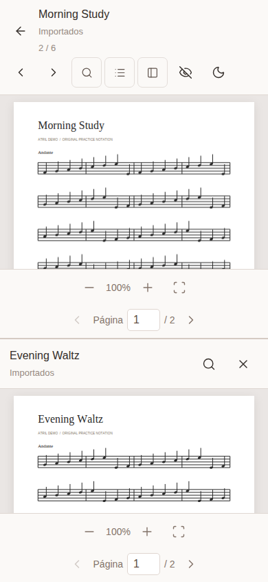

# User guide

[Back to README](../README.md)

Atril's interface is currently in Spanish. The labels below match the application.

## Open your scores

Choose **Abrir PDF** to select files from your device. One selected file opens directly; multiple files appear in the library. These selections last for the current session and must be made again after reloading.

For a reusable library, choose **Vincular carpeta → Vincular otra carpeta** and grant read access. Repeat to link additional folders. Atril preserves subfolder paths and can link an empty folder. It saves local PDF copies, folder references, favorites, and reading progress. PDF copies stay on this device and are not uploaded.

Hidden entries (including Android `.trashed…` and `.pending…` files), dot directories, macOS `__MACOSX` metadata, `$RECYCLE.BIN`, and `~$` temporary entries are excluded. Previously imported hidden files are also hidden from the library; refreshing removes their saved copies.

On browsers without persistent folder access, folder selection is available only for the session. Selecting individual PDFs remains an alternative.

## Refresh and manage folders

When Atril starts, it restores the last imported PDFs without accessing their original folders or asking for permission. To review file changes, choose **Actualizar carpetas** and grant access if the browser requests it. There is no periodic refresh or background monitoring.

If you used an earlier version, refresh each linked folder once to save its first PDF copies.

Use the **⋯** menu beside a linked folder in the sidebar:

- **Restablecer acceso:** renew permission when the browser reports a pending or unavailable connection.
- **Desvincular:** remove the folder link, its saved PDF copies, and reading metadata. Original documents remain untouched.

A warning marker identifies folders whose last update failed or lacked permission. Canceling permission, a failed read, or insufficient storage leaves the previous import readable. A warning does not prevent reading saved PDFs.

File changes are detected by size and modification time. A detected change resets the saved page to page 1. If a PDF already open in the reader changes on disk, reopen it to display the new version.

## Find a score

Search any part of a filename or folder path, including punctuation. Matching ignores case and accents.

Use **Favoritas**, **Recientes**, folder navigation, sorting, and grid/list views to narrow the library. The panel button at the top left hides or shows the sidebar. Desktop visibility is remembered; on phones, selecting a folder or section closes the sidebar.

Phones and tablets use larger interface text and input fields. Touch actions, including folder arrows, favorites, removal, and reader controls, have targets of at least 44 × 44 CSS pixels. Small phones show one card per row, with selection and file actions separated from the PDF preview.

Use the chevron beside a folder to show or hide its subfolders. Clicking the folder name selects its PDFs, including descendants. Each branch keeps its own expansion state. Atril remembers the last folder or section and the sort preference; reopening it renders only that selection instead of all scores. Search text is cleared when changing location and is not restored between visits. If the saved folder is no longer available, startup returns to the full library.

First-page previews load as cards approach the viewport. A sheet-shaped placeholder appears while loading or if a PDF cannot be read. Removing a linked score from the library hides it for the current session; it returns after reloading if its copy is still imported. Refreshing removes its saved copy if it was deleted from the original folder.

## Manage your reading queue

Open **Ver cola** in the reader toolbar to see **Ahora** (the current score), **Añadidas a la cola** (priority additions), and **Secuencia original** (the normal continuation). The panel has **Cola**, **Buscar PDFs**, and **En este PDF** tabs, so you can manage the sequence, add scores, and search document text in one place.

- **Add:** choose **Agregar partituras**, search by name or folder, and press **+** beside a result. It appends the PDF once to the priority additions, before the original continuation; a checkmark identifies a pending addition. The result's **⋯ → Poner siguiente** action places it directly after the current PDF.
- **Reorder:** drag the grip beside an upcoming score within its group. On a keyboard, focus the grip and use Up/Down. The current score and previously read entries remain in place.
- **Remove:** press **×** beside an upcoming score. **Vaciar** clears pending priority additions while keeping the original continuation, current score, and history. These actions leave the PDF files in your library and device.
- **Navigate:** the reader's previous/next PDF buttons and touch swipes follow this sequence. Opening an upcoming score from the queue jumps directly to it; prior entries remain accessible with the previous button.

Queue edits keep the open PDF, page, zoom, and scroll position. To prepare an original sequence, select **Cola** on cards, hold a card for about half a second on touch screens, or use the library's **Ver cola / Abrir cola** actions. The library offers up/down buttons for reordering. Removing or reordering original entries in the reader updates that saved selection; priority additions remain separate.

Opening an unselected PDF starts with the current folder/search order. Priority additions interrupt that sequence and, once read, are consumed: starting at A in A → B → C and adding X gives A → X → B → C. Adding C as a priority gives A → C → B → C, since its original occurrence stays in place. Previous navigation still accesses read entries. Linked-folder selections and pending priority additions survive reloads; the reader's active position and history are session-only. Individually selected PDFs remain session-only. Unavailable entries are pruned when restoring the sequence. Search text is not persisted.

## Read a PDF

Scroll down to read consecutive PDF pages in a continuous column. The page indicator and saved reading page follow your scroll position. Use the lower controls to zoom, fit the pages to the pane's width, or jump to a page number. **← / →** jump between pages in the column. The background toggle changes the space surrounding the PDF; it does not recolor the document itself.

**PDF anterior / PDF siguiente** switch files without returning to the library. They follow the reading list for a selected PDF, or the library order and filters captured when you enter the reader, and stop at either end. Opening an unselected result outside the library filters through reader search starts a separate, single-file selection.

On a touch screen, swipe **left for the next PDF** or **right for the previous PDF** inside the score area. Deliberate horizontal swipes change files; vertical movement scrolls through the PDF's pages. Small drags and multi-finger gestures do not switch files. If the zoomed PDF is wider than its pane, horizontal dragging pans the PDF instead; fit it to the pane to use file swipes again.

Choose **Buscar**:

- **Cola:** review and manage the current and upcoming scores.
- **Buscar PDFs:** find and open another score by filename or path, or add it to the queue.
- **En este PDF:** open a search bar above the score. Terms are highlighted in the PDF, with the active occurrence in orange and a counter such as **1 de 4**. Use the arrows, **Enter**, or **Shift + Enter** to move through occurrences, including repetitions on the same page. Navigation wraps at either end. **Ctrl + F / Cmd + F** opens this bar while reading, and **Esc** closes it and clears highlights. Search ignores case and accents. Image-only scans need OCR, which Atril does not include.

Favorites and the most recent reading page persist for linked files. Files selected individually keep this information only during the session.

## Compare two scores

1. Open a score and choose **Dividir y buscar**.
2. Search for the second score and select it.
3. Scroll, zoom, or turn pages independently in either pane.

Panes are side-by-side on larger screens and stacked on narrow screens. Click or focus a pane before using the arrow keys to select which PDF receives keyboard navigation.

Use **Buscar segunda partitura** to replace the second PDF. **Cerrar división** returns to one pane and keeps the first score open. The second pane has its own page and zoom controls and supports file swipes independently. Its swipe order is the alphabetical library order captured when selecting the second score; the first pane retains its filtered selection. Previous/next-file buttons belong to the first reader.

## Hide reader controls

Choose **Ocultar controles** to hide the upper and lower bars, including the second pane's controls. Both scores continue to scroll independently. Use the floating **Mostrar controles** button or **Esc** to restore the bars.

The fullscreen button uses the browser's fullscreen API when available. Fullscreen and hiding the application's controls are separate options.

## Install and use offline

Visit the deployed HTTPS site online once and wait for the offline-ready notification.

- **Android or desktop:** use **Instalar Atril** or the browser's app installation command when available.
- **iPhone/iPad:** in Safari, use Share → Add to Home Screen.

The cached application can then open local PDFs without an internet connection. Individually selected PDFs still require reselection after reloading. Imported folder PDFs can be read without permission to the original folder. Permission is needed only to import or refresh. Cloud-backed providers may need a connection during those operations.

Saved PDFs use device storage. Clearing site data or browser storage eviction removes the saved library; import the folders again to restore it. Installing the app does not guarantee permanent folder permissions or protect data from deletion.

## Troubleshooting

| Symptom                                | Action                                                                                       |
| -------------------------------------- | -------------------------------------------------------------------------------------------- |
| A linked folder has a warning          | Open its ⋯ menu and choose **Restablecer acceso**. If needed, link it again.                 |
| New or deleted files are not reflected | Choose **Actualizar carpetas**.                                                              |
| The reader shows an older version      | Refresh the library, then reopen the PDF.                                                    |
| Text search finds no matches in a scan | Use a PDF with embedded text; OCR is outside the current scope.                              |
| A PDF will not open                    | Check that it is a valid, unencrypted PDF. Refresh or reimport if its saved copy is missing. |
| Folder linking is unavailable          | Use session-only folder selection or individual files in that browser.                       |
